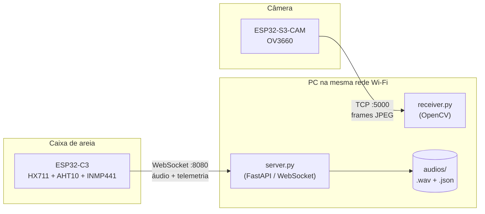
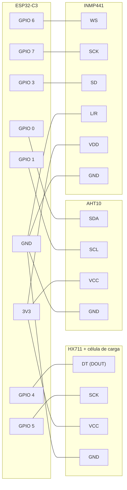
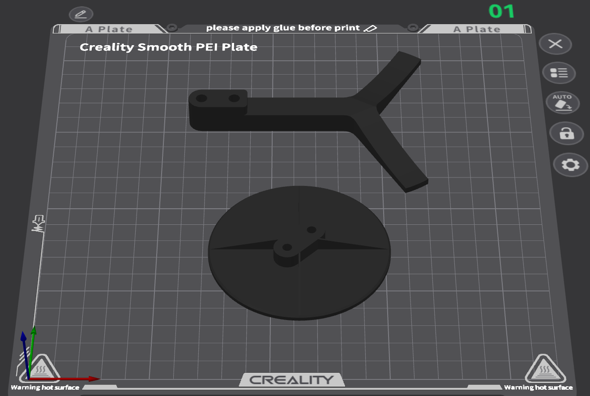
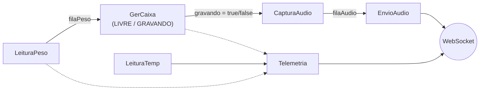

# 🐱 Sistema de detecção da Síndrome de Pandora

> [!NOTE]
> **Status atual:** protótipo funcional de coleta de dados. O servidor recebe e **armazena** os áudios e a telemetria, mas ainda **não há análise (ML)** nem interface final.

---

## Índice

1. [Visão geral](#1-visão-geral)
2. [Hardware](#2-hardware)
3. [Firmware (ESP32-C3)](#3-firmware-esp32-c3)
4. [Firmware (ESP32-S3-CAM)](#4-firmware-esp32-s3-cam)
5. [Software no PC (Python)](#5-software-no-pc-python)
6. [Como rodar](#6-como-rodar)
7. [Estrutura do repositório](#7-estrutura-do-repositório)
8. [Limitações conhecidas e próximos passos](#8-limitações-conhecidas-e-próximos-passos)

---

## 1. Visão geral

O projeto é dividido em **dois subsistemas independentes**, que se comunicam com o PC pela rede Wi-Fi local:

| Subsistema | Placa | O que faz | Protocolo | Script no PC |
|---|---|---|---|---|
| **Sensores + áudio** | ESP32-C3 | Pesa, mede temperatura/umidade, grava áudio quando o gato entra | WebSocket (porta 8080) | `python/server.py` |
| **Vídeo** | ESP32-S3-CAM (OV3660) | Transmite vídeo JPEG ao vivo | TCP bruto (porta 5000) | `python/receiver.py` |



**Fluxo de uso (ESP32-C3):**

1. A balança fica sob a caixa. Quando o peso passa de um limite, o sistema entende que o gato entrou.
2. O microfone começa a gravar e o áudio é enviado em pedaços (*chunks*) ao servidor.
3. Quando o peso volta a ficar baixo, a gravação termina e o servidor salva o arquivo `.wav` + um `.json` com metadados.
4. Em paralelo, a cada 2 s, um pacote de telemetria (peso, temperatura, umidade, presença) é enviado.

---

## 2. Hardware

### 2.1 Lista de componentes

| Componente | Função | Observação |
|---|---|---|
| ESP32-C3 (SuperMini / DevKitM-1) | Microcontrolador principal da caixa | Núcleo único, Wi-Fi integrado |
| Célula de carga + **HX711** | Medição de peso | Testes feitos com célula de **5 kg** |
| **INMP441** | Microfone digital I2S | Alimentar com **3,3 V** |
| **AHT10** | Temperatura e umidade (I2C) | Alimentar com 3,3 V |
| ESP32-S3-CAM (N16R8) + **OV3660** | Câmera | Pinagem padrão Freenove / ESP32-S3-EYE |
| Suporte impresso em 3D | Fixação da célula de carga | Ver [seção 2.4](#24-suporte-impresso-em-3d-da-célula-de-carga) |

### 2.2 Ligações do ESP32-C3



**Tabela de pinos (`src/esp_c3.cpp`):**

| Periférico | Pino do periférico | Pino do ESP32-C3 | Observação |
|---|---|---|---|
| **HX711** | DT / DOUT | `GPIO 4` | |
| | SCK | `GPIO 5` | |
| | VCC / GND | `3V3` / `GND` | |
| **AHT10** (I2C) | SDA | `GPIO 0` | |
| | SCL | `GPIO 1` | |
| | VCC / GND | `3V3` / `GND` | |
| **INMP441** (I2S) | WS (LRCL) | `GPIO 6` | |
| | SCK (BCLK) | `GPIO 7` | |
| | SD (DOUT) | `GPIO 3` | |
| | L/R | `GND` | Seleciona o canal **esquerdo** (o firmware lê o canal 0) |
| | VDD / GND | `3V3` / `GND` | |

> [!WARNING]
> **GPIO 0:** o driver I2S, por padrão, emite um sinal MCLK nesse pino. Como ele é usado como SDA do AHT10, o firmware força `mck_io_num = I2S_PIN_NO_CHANGE`.
> 
> **Célula de carga → HX711:** as 4 fios da célula (normalmente vermelho = E+, preto = E−, branco = A−, verde = A+) vão nos bornes correspondentes do HX711. As cores podem variar entre fabricantes.

### 2.3 Ligações do ESP32-S3-CAM

A câmera usa a pinagem padrão da placa (Freenove / ESP32-S3-EYE).

| Sinal da câmera | GPIO | | Sinal da câmera | GPIO |
|---|---|---|---|---|
| XCLK | 15 | | D3 (Y5) | 10 |
| SIOD (SDA) | 4 | | D2 (Y4) | 8 |
| SIOC (SCL) | 5 | | D1 (Y3) | 9 |
| D7 (Y9) | 16 | | D0 (Y2) | 11 |
| D6 (Y8) | 17 | | VSYNC | 6 |
| D5 (Y7) | 18 | | HREF | 7 |
| D4 (Y6) | 12 | | PCLK | 13 |

`PWDN` e `RESET` não são usados (`-1`).

### 2.4 Suporte impresso em 3D da célula de carga

Para a **leitura correta do peso**, foi necessário **imprimir um suporte em 3D** que mantém a célula de carga bem ajustada e alinhada. Sem uma fixação firme, a célula flexiona de forma irregular e as leituras ficam instáveis e imprecisas.



### 2.5 Sobre a célula de carga (5 kg → 20 kg)

- **Todos os testes até agora foram feitos com a célula de 5 kg.**
- **Pretende-se migrar para a célula de 20 kg**, para ter margem de peso (caixa + areia + gato).
- Ao trocar a célula será necessário:
  1. **Recalibrar** o `CALIBRATION_FACTOR` (hoje `420.0`, valor encontrado empiricamente para a célula de 5 kg).
  2. **Revisar os limiares de presença** (`PESO_INICIO_GRAVACAO_G` = 200 g e `PESO_FIM_GRAVACAO_G` = 100 g).
  3. Possivelmente **adaptar o suporte 3D** às dimensões da nova célula.

---

## 3. Firmware (ESP32-C3)

Arquivo: [`src/esp_c3.cpp`](src/esp_c3.cpp) · Ambiente PlatformIO: `esp32-c3-supermini`

### 3.1 Configuração (constantes no topo do arquivo)

| Constante | Valor atual | Para que serve |
|---|---|---|
| `WIFI_SSID` / `WIFI_SENHA` | `"ssid"` / `"password"` | **Edite** com os dados da sua rede |
| `WS_HOST` | `192.168.1.104` | **IP do PC** que roda o `server.py` |
| `WS_PORT` / `WS_PATH` | `8080` / `/ws/caixa_areia` | Endereço do WebSocket |
| `CALIBRATION_FACTOR` | `420.0` | Calibração da célula de carga |
| `ZERO_THRESHOLD` | `0.5` g | Zona morta: leituras abaixo disso viram `0` |
| `PESO_INICIO_GRAVACAO_G` | `200` g | Acima disso, o gato é considerado presente |
| `PESO_FIM_GRAVACAO_G` | `100` g | Abaixo disso, o gato é considerado ausente |
| `LEITURAS_CONFIRMA_ENTRADA` | `2` | Leituras seguidas acima do limiar para **iniciar** |
| `LEITURAS_CONFIRMA_SAIDA` | `3` | Leituras seguidas abaixo do limiar para **finalizar** |
| `INTERVALO_TELEMETRIA_MS` | `2000` | Período do pacote de telemetria |
| `AUDIO_SHIFT_BITS` | `14` | Ganho do áudio (16 = ganho unitário; 14 ≈ +12 dB) |

### 3.2 Organização em tarefas (FreeRTOS)

O ESP32-C3 tem um único núcleo, então o trabalho é dividido em tarefas com prioridades diferentes. O `loop()` do Arduino fica vazio.

| Tarefa | Prioridade | O que faz |
|---|---|---|
| `CapturaAudio` | 3 (maior) | Lê o microfone via I2S **somente enquanto `gravando == true`** e coloca os chunks numa fila |
| `EnvioAudio` | 2 | Envia `start_audio`, os chunks e `stop_audio` ao servidor, **nessa ordem** (tudo sai de uma única tarefa) |
| `GerCaixa` | 2 | Máquina de estados `LIVRE` ↔ `GRAVANDO` (decide quando o gato entrou/saiu) |
| `LeituraPeso` | 1 | Lê o HX711 (média de 3 leituras), publica o peso e alimenta o `GerCaixa` |
| `LeituraTemp` | 1 | Lê o AHT10 a cada 2 s; se o sensor falhar, tenta reinicializá-lo |
| `Telemetria` | 1 | Monta e envia o JSON de telemetria a cada 2 s |



### 3.3 Detecção de presença (histerese)

Para evitar que o sistema "pisque" entre presente/ausente, são usados **dois limiares** e **confirmação por leituras consecutivas**:

- **LIVRE → GRAVANDO:** peso `> 200 g` por **2 leituras seguidas** **e** WebSocket conectado.
- **GRAVANDO → LIVRE:** peso `< 100 g` por **3 leituras seguidas**.
- Entre 100 g e 200 g, o estado atual é mantido.

> Se o servidor estiver desconectado quando o gato entrar, a gravação **não** começa (tenta de novo na próxima leitura). Isso evita acumular áudio velho.

### 3.4 Quando e como cada mensagem é enviada

Tudo vai por **uma única conexão WebSocket** (`ws://<WS_HOST>:8080/ws/caixa_areia`). A conexão tem *ping/pong* a cada 5 s (timeout de 10 s) para detectar quedas, e reconecta sozinha.

| Mensagem | Tipo | Quando é enviada | Conteúdo |
|---|---|---|---|
| `start_audio` | texto | Assim que `gravando` vira `true` (gato entrou) e há conexão | Apenas a palavra `start_audio` |
| **Chunk de áudio** | binário | Continuamente durante a gravação, ~**31 por segundo** | 512 amostras PCM, **16 bits, mono, 16 kHz, little-endian** (1024 bytes = 32 ms) |
| `stop_audio` | texto | Depois que o gato saiu, a fila de áudio esvaziou e passaram ~50 ms | Apenas a palavra `stop_audio` |
| **Telemetria** | texto (JSON) | A cada **2 s**, enquanto conectado (sempre, com ou sem gato) | Ver abaixo |

**Formato da telemetria:**

```json
{
  "tipo": "telemetria",
  "peso_g": 123.45,
  "temperatura_c": 27.3,
  "umidade_pct": 61.2,
  "gato_presente": false,
  "uptime_s": 5231
}
```

- Se um sensor falhar, o campo correspondente vai como `null` (ex.: `"peso_g": null`).
- `gato_presente` é `true` enquanto o firmware está gravando.

**Resposta do servidor:** após o `stop_audio`, o servidor responde com o texto `salvo audios/<arquivo>.wav`. O firmware apenas imprime essa resposta na Serial.

### 3.5 Robustez no envio de áudio

- Se a rede engasgar, a fila de áudio (64 chunks ≈ 2 s) descarta o **chunk mais antigo** e mantém o mais novo. O número de chunks perdidos e de falhas de envio é impresso na Serial ao fim de cada gravação.
- Se o WebSocket cair, o áudio acumulado é descartado (não é enviado depois da reconexão) e uma nova sessão é aberta com um novo `start_audio` quando possível.
- A conversão de 32 → 16 bits aplica **saturação** (clipping) para não gerar distorção por *overflow*.

### 3.6 Inicialização (`setup`)

1. Inicia o HX711 e faz a **tara** → ⚠️ **a caixa deve estar vazia ao ligar o dispositivo.**
2. Inicia o I2C (AHT10).
3. Conecta ao Wi-Fi (timeout de 20 s; se falhar, o driver continua tentando em segundo plano).
4. Cria as filas, instala o I2S, inicia o WebSocket e cria as tarefas.

---

## 4. Firmware (ESP32-S3-CAM)

Arquivo: [`src/esp_cam.cpp`](src/esp_cam.cpp) · Ambiente PlatformIO: `esp32-s3-devkitm-1`

A câmera funciona como um **servidor TCP** (porta `5000`). Quando o `receiver.py` conecta, a placa envia frames JPEG continuamente.

**Protocolo (por frame):**

```
[ uint32 little-endian: tamanho N ][ N bytes de JPEG ]
```

Escolhas de projeto (para baixa latência):

- **TCP bruto com prefixo de tamanho**: sem HTTP/multipart, só 4 bytes de overhead.
- **`TCP_NODELAY`** ligado e **Wi-Fi sem economia de energia** (`WiFi.setSleep(false)`).
- **`CAMERA_GRAB_LATEST`**: se a rede atrasar, frames antigos são descartados e o mais recente é enviado.
- JPEG gerado **por hardware** pelo sensor (CPU livre) e 2 *frame buffers* na PSRAM.

Configurações editáveis no topo do arquivo: `WIFI_SSID`, `WIFI_PASS`, `TCP_PORT`, `FRAME_SIZE` (QVGA 320×240 ou VGA 640×480), `JPEG_QUALITY` (0–63, **menor = melhor qualidade**), `XCLK_HZ`, `FLIP_VERTICAL`.

> O módulo configurado é o **N16R8** (16 MB flash + 8 MB PSRAM octal). Para N8R2, veja os comentários no `platformio.ini`.

---

## 5. Software no PC (Python)

Hoje existem **dois scripts independentes**, um para cada placa. Eles não compartilham código nem processo.

> [!TIP]
> **Evolução sugerida:** unificar os dois em um único serviço (por exemplo, um único app FastAPI que receba o WebSocket de áudio/telemetria **e** o stream da câmera, ou que exponha ambos numa interface/dashboard única).

### 5.1 `python/server.py` — recepção da caixa de areia (ESP32-C3)

Servidor **FastAPI** com um endpoint WebSocket.

**Endpoints:**

| Endpoint | Tipo | Descrição |
|---|---|---|
| `/ws/caixa_areia` | WebSocket | Recebe comandos, áudio e telemetria do ESP32-C3 |
| `/telemetria` | `GET` | Retorna o **último** pacote de telemetria recebido (útil para conferir o firmware) |

**Como ele trata cada mensagem:**

| Mensagem recebida | O que o servidor faz |
|---|---|
| `start_audio` | Cria um novo arquivo WAV (`gato_AAAAMMDD_HHMMSS_micros.wav`). Se já havia uma gravação aberta, fecha a anterior (motivo `reiniciada_por_novo_start`) e abre outra |
| Binário (PCM) | Anexa ao WAV aberto, gravando **incrementalmente** em disco (não acumula na RAM). Atualiza estatísticas (pico, RMS, amostras saturadas). Se chegar sem `start_audio`, descarta e avisa uma vez |
| `stop_audio` | Fecha o WAV, grava o `.json` de metadados e responde `salvo <arquivo>` |
| JSON `{"tipo":"telemetria",...}` | Guarda **somente o último valor, em memória**, com o campo extra `recebido_em` |
| Conexão cai no meio da gravação | Fecha e preserva o que já chegou (motivo `conexao_encerrada`) |

**Princípio importante:** o WAV salvo é o **áudio bruto**, exatamente como chegou. **Não há** corte de silêncio, normalização ou filtro, porque sons de gato podem ser baixos, curtos e raros.

**Arquivos gerados** (pasta `python/audios/`, ignorada pelo git):

```
audios/
├── gato_20260315_142530_123456.wav    # áudio bruto (16 kHz, 16 bits, mono)
└── gato_20260315_142530_123456.json   # metadados
```

**Exemplo de metadados (`.json`):**

```json
{
  "arquivo": "audios/gato_20260315_142530_123456.wav",
  "inicio": "2026-03-15T14:25:30.123-03:00",
  "fim": "2026-03-15T14:26:10.456-03:00",
  "fuso": "America/Fortaleza",
  "duracao_s": 40.33,
  "sample_rate": 16000,
  "bytes": 1290560,
  "chunks": 1260,
  "pico": 8123,
  "pico_dbfs": -12.1,
  "rms_dbfs": -38.4,
  "amostras_saturadas": 0,
  "motivo_fechamento": "stop_audio",
  "suspeita_mic_mudo": false,
  "suspeita_clipping": false
}
```

- `suspeita_mic_mudo`: o pico ficou abaixo de 20 (provável problema de fiação do INMP441).
- `suspeita_clipping`: mais de 0,1 % das amostras saturaram (considere aumentar `AUDIO_SHIFT_BITS` no firmware, que **diminui** o ganho).
- Esses campos só **sinalizam**; o arquivo é sempre mantido.

**Variáveis de ambiente (opcionais):**

| Variável | Padrão | Descrição |
|---|---|---|
| `AUDIO_DIR` | `./audios` | Pasta de saída dos áudios |
| `FUSO_HORARIO` | `America/Fortaleza` | Fuso IANA usado em nomes de arquivo, metadados e logs |
| `LOG_TELEMETRIA` | `1` | `1` imprime cada pacote de telemetria no log |

**Ponto de extensão:** há um comentário no código (`>>> Ponto de extensão <<<`), logo após o salvamento do áudio, indicando onde disparar a futura **análise de ML**.

### 5.2 `python/receiver.py` — visualizador da câmera (ESP32-S3-CAM)

Cliente que conecta na câmera e exibe o vídeo com OpenCV. Foi desenhado para **baixa latência e máximo FPS**, com um pipeline de 3 estágios, cada um em sua thread:

```
[Thread NET]  →  [Thread DECODE]  →  [Thread MAIN]
 lê o socket      cv2.imdecode        imshow / waitKey
```

Cada estágio trabalha sempre com o **item mais recente** e descarta o que ficou velho (classe `LatestSlot`), de modo que o atraso nunca se acumula. Se a conexão cair, reconecta sozinho com *backoff* exponencial (até 3 s) e mostra uma tela "Aguardando camera...".

**Parâmetros:**

```bash
python receiver.py <IP_DA_CAMERA> [--port 5000] [--reduce 1|2|4|8] [--no-hud]
```

| Parâmetro | Descrição |
|---|---|
| `host` | IP do ESP32-S3-CAM (aparece na Serial ao ligar) |
| `--port` | Porta TCP (padrão `5000`) |
| `--reduce` | Decodifica em 1/N da resolução (mais rápido, imagem menor) |
| `--no-hud` | Esconde o contador de FPS sobre a imagem |

Teclas: `q` ou `ESC` para sair. Atualmente o receiver **só exibe** o vídeo (não grava nem processa).

---

## 6. Como rodar

### 6.1 Pré-requisitos

- [PlatformIO](https://platformio.org/) (VS Code ou CLI)
- Python 3.10+
- PC e placas **na mesma rede Wi-Fi**

### 6.2 Servidor da caixa de areia

```bash
cd python
pip install fastapi "uvicorn[standard]" numpy tzdata
uvicorn server:app --host 0.0.0.0 --port 8080
```

Descubra o IP do PC (`ipconfig` no Windows / `ip a` no Linux) e coloque-o em `WS_HOST` no `src/esp_c3.cpp`. Em seguida, coloque também o SSID e a senha do Wi-Fi.

### 6.3 Gravar o firmware

```bash
# ESP32-C3 (caixa de areia)
pio run -e esp32-c3-supermini -t upload

# ESP32-S3-CAM (câmera)
pio run -e esp32-s3-devkitm-1 -t upload
```

Abra o monitor serial (`pio device monitor`, 115200 baud) para ver os logs e o IP da câmera.

### 6.4 Visualizar a câmera

```bash
cd python
pip install opencv-python numpy
python receiver.py <IP_DA_CAMERA>
```

### 6.5 Conferindo se está funcionando

- No terminal do servidor devem aparecer `Cliente conectado` e, a cada 2 s, linhas `Telemetria: ...`.
- Abra `http://<IP_DO_PC>:8080/telemetria` no navegador para ver o último pacote.
- Coloque um peso acima de 200 g na balança: o servidor deve logar `Gato entrou`, e ao retirar, `Gato saiu` + o arquivo salvo.

---

## 7. Estrutura do repositório

```
.
├── platformio.ini          # 2 ambientes: esp32-s3-devkitm-1 (câmera) e esp32-c3-supermini (caixa)
├── src/
│   ├── esp_c3.cpp          # Firmware da caixa de areia (HX711 + AHT10 + INMP441 + WebSocket)
│   └── esp_cam.cpp         # Firmware da câmera (ESP32-S3-CAM + OV3660, TCP bruto)
└── python/
    ├── server.py           # Servidor WebSocket da caixa de areia (grava áudio e telemetria)
    ├── receiver.py         # Visualizador do stream da câmera
    └── audios/             # Saída dos áudios (gerada em execução, ignorada pelo git)
```

---

## 8. Limitações conhecidas e próximos passos

**Limitações atuais**

- Telemetria guardada **apenas em memória** (só o último pacote; some ao reiniciar o servidor).
- Sem análise do áudio: os arquivos são só **armazenados**.
- Credenciais de Wi-Fi e IP do servidor estão **fixos no código** (cada mudança de rede exige regravar o firmware).
- Dois scripts Python separados, sem integração entre áudio/sensores e vídeo.
- Receiver de vídeo apenas exibe; não grava nem analisa imagens.
- Calibrado e testado somente com a célula de **5 kg**.
- Sem autenticação/criptografia no WebSocket (uso previsto em rede local).

**Sugestões de evolução**

1. **Unificar** `server.py` e `receiver.py` em um único serviço/aplicação.
2. Persistir a telemetria em banco de dados (ex.: SQLite) e relacioná-la aos áudios (hoje a ligação seria por horário).
3. Implementar a **análise de ML** no ponto de extensão do `server.py`.
4. Criar um **dashboard** (peso ao longo do tempo, histórico de visitas, temperatura/umidade, vídeo ao vivo).
5. Migrar para a célula de **20 kg** (recalibrar, revisar limiares e suporte 3D).
6. Tornar a configuração (Wi-Fi, IP do servidor) editável sem regravar o firmware (ex.: portal de configuração ou mDNS).
